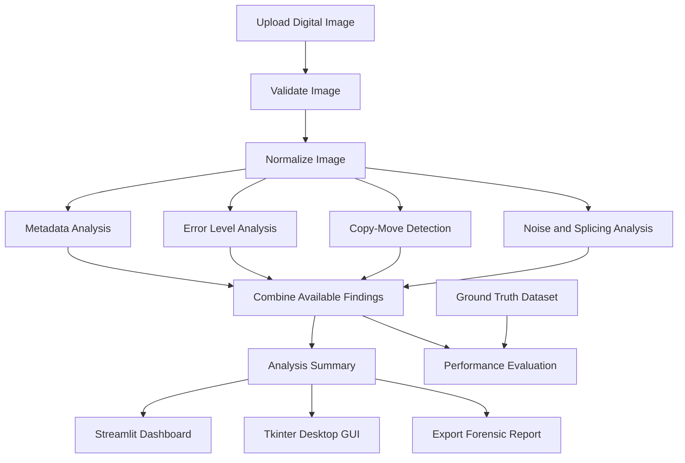

# 🔍 Image Forensic Analyzer for Digital Tampering Detection

**Multimedia Forensics Lab — Mini Project**

An interactive digital forensics application that analyzes digital images for potential manipulation using image processing, metadata inspection, and computer vision techniques.


---

## 📌 1. Project Overview

### What is Image Tampering?

Image tampering is the intentional modification of a digital image to change its original content or misrepresent information. It may involve duplicating objects, inserting foreign objects, removing details, or modifying specific regions.

Such alterations can be difficult to identify through visual inspection alone.

### Project Objective

The **Image Forensic Analyzer** is designed to examine digital images and identify suspicious patterns that may indicate manipulation.

The application combines multiple forensic techniques to generate visual evidence, inspect image metadata, and present an overall analysis through an interactive dashboard.

### Key Features

- **Image Upload:** Analyze supported image formats such as JPG, JPEG, PNG, WEBP, BMP, and TIFF, subject to library and decoder support.
- **Metadata Analysis:** Inspect available EXIF information, timestamps, camera details, and software tags.
- **Error Level Analysis (ELA):** Visualize JPEG recompression differences that may reveal suspicious regions.
- **Copy-Move Detection:** Use ORB feature matching to identify potential duplicated regions within an image.
- **Noise Analysis:** Examine local noise and residual variations that may indicate inconsistent image processing.
- **Splicing Analysis:** Identify suspicious regions using available noise, edge, and image-statistics information.
- **Visual Evidence:** Display analysis outputs, heatmaps, feature matches, and relevant image statistics.
- **Forensic Report:** Export supported analysis results in JSON or PDF format, depending on the implemented reporting functionality.
- **Web Dashboard:** Use an interactive Streamlit interface to upload and analyze images.
- **Desktop Interface:** Provide a separate Tkinter interface for supported offline workflows.
- **Performance Evaluation:** Evaluate the detector against a labeled dataset using classification metrics.

### Real-World Applications

1. **Insurance Fraud Investigation:** Examine accident photographs for potentially duplicated or altered damage.
2. **Digital Evidence Verification:** Assist investigators in reviewing photographs submitted as evidence.
3. **Journalism and Fact-Checking:** Examine suspicious photographs circulating online.
4. **Identity Document Verification:** Identify possible inconsistencies in images of identity documents.
5. **Cybercrime Investigation:** Support preliminary analysis of suspicious digital images.

*This project is an academic forensic analysis tool. Its results should be interpreted alongside other evidence and expert review.*

---

## 🏗️ 2. System Architecture

The application follows a modular image-analysis workflow.



### Workflow Explanation

1. **Image Input:** The user uploads an image or selects a supported sample.
2. **Image Validation:** The application checks whether the file can be opened and processed.
3. **Image Normalization:** The image is converted into a suitable representation for analysis while preserving the original upload for reference.
4. **Metadata Inspection:** Available image metadata is extracted and examined.
5. **Forensic Analysis:** ELA, ORB-based copy-move detection, and noise analysis are performed where applicable.
6. **Finding Aggregation:** The available analysis results are combined to produce a summary.
7. **Result Visualization:** The dashboard displays findings and supporting visual evidence.
8. **Report Generation:** Supported results are exported for documentation.
9. **Performance Evaluation:** A separate evaluation module measures detector performance on labeled samples.

---

## 🛠️ 3. Technology Stack

| Technology | Purpose |
|---|---|
| Python 3.11 | Core application development |
| Streamlit | Interactive web dashboard |
| Tkinter | Desktop graphical interface |
| OpenCV | Image processing and ORB feature detection |
| NumPy | Numerical calculations and pixel-array operations |
| Pillow (PIL) | Image loading, conversion, and JPEG recompression |
| Matplotlib | Graphs, heatmaps, and forensic visualizations |
| Scikit-image | Additional image-processing and similarity functions, where implemented |
| JSON | Structured metadata and report storage |
| Jupyter Notebook | Interactive experiments and demonstrations |
| VS Code | Development, debugging, and project execution |

*The final dependencies and features depend on the actual implementation in the project source files.*

---

## 🔬 4. Forensic Detection Techniques

### 4.1 Error Level Analysis (ELA)

**Purpose:** Examine differences introduced by JPEG recompression.

ELA compares an image with a recompressed version of itself. Regions with different compression histories may produce different error patterns.

A simplified expression is:

\[
E(x,y)=|I(x,y)-I_Q(x,y)|
\]

Where:

- \(I(x,y)\) represents the original pixel.
- \(I_Q(x,y)\) represents the recompressed pixel at quality setting \(Q\).
- \(E(x,y)\) represents the pixel-level difference.

**Advantages**
- Provides a visual representation of compression differences.
- May highlight regions that deserve further investigation.
- Can support the analysis of some JPEG images.

**Limitations**
- ELA is primarily intended for JPEG recompression analysis.
- Resizing, repeated saving, and image processing can affect the result.
- Bright regions do not automatically prove tampering.
- PNG and other lossless formats require different interpretations.

### 4.2 Copy-Move Forgery Detection using ORB

**Purpose:** Identify possible duplicated image regions.

Copy-move manipulation occurs when a region of an image is copied and pasted elsewhere in the same image.

The ORB (Oriented FAST and Rotated BRIEF) algorithm detects distinctive image features and generates descriptors for matching.

A typical workflow is:

1. Detect keypoints in the image.
2. Generate ORB descriptors.
3. Match similar descriptors.
4. Filter unreliable matches.
5. Use spatial consistency checks, such as RANSAC when implemented, to examine possible duplicated regions.
6. Visualize relevant keypoints or matches.

**Advantages**
- Does not require a separate original image.
- Can identify potential duplicated objects or regions.
- Is relatively efficient for feature-based matching.

**Limitations**
- Smooth regions may contain too few distinctive features.
- Repetitive textures can produce false matches.
- Resizing, rotation, compression, and other transformations can reduce detection performance.

### 4.3 Noise Residual and Splicing Analysis

**Purpose:** Identify unusual local noise patterns that may indicate image inconsistencies.

Images contain noise from sensors, compression, and processing operations. When content from different sources is combined, the resulting regions may have different noise characteristics.

A simplified analysis can compare local noise statistics across image regions.

For example, a ratio between a high-percentile local noise value and the median may help identify unusually noisy areas when the implementation supports this measurement.

**Advantages**
- Can provide additional evidence beyond metadata and ELA.
- May reveal differences between image regions.
- Can complement copy-move analysis.

**Limitations**
- Noise differences may result from lighting, camera settings, denoising, or compression.
- A noise anomaly does not necessarily indicate splicing.
- Reliable sensor-pattern noise analysis requires suitable images and careful calibration.

### 4.4 EXIF and Header Metadata Analysis

**Purpose:** Inspect available metadata for useful forensic information.

EXIF metadata may contain:

- Camera manufacturer and model.
- Capture date and time.
- Image dimensions.
- Camera settings.
- Software or editing information, when recorded.

The analyzer can also inspect available file information to support the investigation.

**Advantages**
- Provides useful contextual information.
- May reveal editing software tags or unexpected metadata.
- Helps document the properties of the analyzed file.

**Limitations**
- Metadata can be removed, edited, or fabricated.
- Missing EXIF information does not prove manipulation.
- A software tag alone cannot establish that an image has been tampered with.

---

## 📂 5. Project Directory Structure

```text
multimedia project/
│
├── app.py
├── main.py
├── gui_tkinter.py
├── evaluate.py
├── generate_sample_data.py
├── test_system.py
├── requirements.txt
├── README.md
│
├── dataset/
│   ├── authentic/
│   ├── tampered/
│   │   ├── copy_move/
│   │   └── splicing/
│   └── ground_truth.json
│
├── src/
│   ├── __init__.py
│   ├── ela.py
│   ├── copy_move.py
│   ├── splicing_detection.py
│   ├── metadata_analyzer.py
│   └── utils.py
│
├── notebooks/
│   └── Image_Forensic_Analyzer_Demo.ipynb
│
└── reports/
    └── confusion_matrix.png
```

**Directory descriptions**

- `app.py` — Streamlit web application.
- `main.py` — Command-line entry point and any supported unified execution options.
- `gui_tkinter.py` — Desktop graphical interface.
- `src/` — Modular image-analysis functions.
- `dataset/` — Authentic and manipulated sample images with labels.
- `evaluate.py` — Performance evaluation.
- `generate_sample_data.py` — Sample dataset generation.
- `test_system.py` — Automated tests.
- `notebooks/` — Interactive demonstration.
- `reports/` — Evaluation outputs and generated reports.

*Some folders or files may be optional or named differently in a particular project version. Keep this documentation aligned with the files that actually exist in your repository.*

---

## 🚀 6. Installation and Execution

### Prerequisites

- Python 3.11 recommended.
- Visual Studio Code or another Python IDE.
- Required Python libraries.
- A supported operating system.

### Step 1: Open the Project

Extract the project ZIP file to a normal folder. Open that extracted folder in VS Code.

Open the integrated terminal using:

`Terminal → New Terminal`

Ensure the terminal is inside the folder containing `app.py` and `requirements.txt`.

### Step 2: Install Dependencies

```bash
python -m pip install -r requirements.txt
```

### Step 3: Generate Sample Data (Optional)

```bash
python generate_sample_data.py
```

Run this command only if the project includes the generator and you need to create its sample dataset.

### Step 4: Launch the Streamlit Dashboard

```bash
python -m streamlit run app.py
```

Streamlit will display a local URL in the terminal, usually:

`http://localhost:8501`

Open that address in your browser if it does not open automatically.

### Step 5: Launch the Desktop Interface

```bash
python gui_tkinter.py
```

### Step 6: Run Performance Evaluation

```bash
python evaluate.py
```

This command should run the evaluation implemented by the project and generate its configured output files.

### Step 7: Run Automated Tests

```bash
python test_system.py
```

### Step 8: Analyze a Single Image (Optional)

If the command-line interface supports the `--image` argument:

```bash
python main.py --image "dataset/tampered/copy_move/example.jpg"
```

Use the actual image path and command-line options supported by your implementation.

---

## 🖥️ 7. How to Use the Application

1. Launch the Streamlit dashboard.
2. Upload an image in a supported format.
3. Wait for the image validation and analysis to finish.
4. Review the available metadata.
5. Examine the ELA visualization, where applicable.
6. Review ORB keypoint matches and possible duplicated regions.
7. Inspect noise or splicing analysis outputs.
8. Read the overall analysis summary.
9. Export the available report, if report generation is implemented.
10. Repeat the analysis with other images for comparison.

**Important:** Preserve the original image and document its source when conducting a real forensic investigation. Perform analysis on a working copy whenever possible.

---

## 📊 8. Performance Evaluation

The project can be evaluated using a labeled dataset containing authentic and manipulated images.

### Evaluation Metrics

| Metric | Meaning |
|---|---|
| Accuracy | Proportion of all predictions that are correct |
| Precision | Proportion of predicted positive cases that are actually positive |
| Recall | Proportion of actual positive cases correctly identified |
| Specificity | Proportion of actual negative cases correctly identified |
| F1-score | Harmonic mean of precision and recall |
| Confusion Matrix | Summary of correct and incorrect classifications |

For binary classification:

\[
\text{Accuracy}=\frac{TP+TN}{TP+TN+FP+FN}
\]

\[
\text{Precision}=\frac{TP}{TP+FP}
\]

\[
\text{Recall}=\frac{TP}{TP+FN}
\]

\[
\text{Specificity}=\frac{TN}{TN+FP}
\]

\[
F1=2\cdot\frac{\text{Precision}\cdot\text{Recall}}
{\text{Precision}+\text{Recall}}
\]

Where:

- **TP:** Tampered images correctly identified as tampered.
- **TN:** Authentic images correctly identified as authentic.
- **FP:** Authentic images incorrectly identified as tampered.
- **FN:** Tampered images incorrectly identified as authentic.

If a denominator is zero, the metric requires an appropriate undefined-value or zero-division convention.

### Reporting Results

Run:

```bash
python evaluate.py
```

Report the actual metrics generated by the evaluation script. Include the dataset size, class distribution, test procedure, and confusion matrix where available.

Do not report 100% accuracy, precision, recall, specificity, or F1-score unless the corresponding measurements have actually been obtained and verified. Performance on a small synthetic dataset does not necessarily generalize to real-world manipulated images.

---

## 🧪 9. Suggested Demonstration Plan

### Demonstration 1: Authentic Image

- Upload a known authentic image.
- Review the metadata.
- Inspect the ELA and noise visualizations, if supported.
- Explain why no single analysis result is sufficient to establish authenticity.

### Demonstration 2: Copy-Move Image

- Upload an image containing a deliberately duplicated object.
- Open the copy-move analysis output.
- Explain ORB keypoints, descriptor matching, and spatial consistency filtering.

### Demonstration 3: Spliced Image

- Upload an image containing an object inserted from another source.
- Review the noise and splicing outputs.
- Explain how inconsistent local image characteristics can help identify suspicious regions.

### Demonstration 4: Performance Evaluation

- Run `python evaluate.py`.
- Display the measured metrics and confusion matrix.
- Explain false positives and false negatives.

### Demonstration 5: Report Generation

- Analyze a sample image.
- Export the available report.
- Explain how the findings and supporting evidence can be documented.

*Use the actual sample images, dashboard tabs, and report features available in your implementation. Do not demonstrate features that are not present in the application.*

---

## ⚠️ 10. Limitations and Responsible Use

- No single forensic technique detects every form of image manipulation.
- ELA results depend on compression history and image format.
- ORB detection depends on the presence of suitable image features.
- Noise analysis can be affected by image processing and acquisition conditions.
- Metadata may be missing or unreliable.
- A suspicious result is not conclusive proof of tampering.
- Evaluation results depend on dataset quality, size, and diversity.
- Results should be independently verified before being used in legal, financial, or investigative decisions.

The application is intended to assist image examination and academic learning. It should not be treated as a replacement for a qualified forensic examiner.

---

## 🛠️ 11. Troubleshooting

### Streamlit command not found

Try:

```bash
python -m pip install streamlit
```

Then:

```bash
python -m streamlit run app.py
```

### Missing Python package

Run:

```bash
python -m pip install -r requirements.txt
```

### `UploadedFile` has no `getexif()` method

Streamlit's uploaded file object is not itself a Pillow image. Open the uploaded data with Pillow before accessing EXIF metadata.

For example:

```python
from PIL import Image

image = Image.open(uploaded_file)
metadata = image.getexif()
```

Use this pattern only where the code expects a Pillow image. Do not change unrelated application logic.

### Image cannot be opened

Check that the file is valid, supported by the installed image decoder, and not corrupted. Handle invalid uploads gracefully.

### Import errors involving `src`

Run commands from the project root directory, where `app.py` and the `src` folder are located.

### Port already in use

Run Streamlit on another available port:

```bash
python -m streamlit run app.py --server.port 8502
```

---

## 🔮 12. Future Enhancements

- Improve copy-move detection for rotated and scaled objects.
- Add more robust splicing-detection methods.
- Include richer visual explanations of suspicious regions.
- Add batch image analysis.
- Improve report generation and evidence documentation.
- Evaluate performance on larger, independently sourced forensic datasets.
- Add reproducible experiment settings and structured test results.
- Explore machine-learning-based detection with appropriate training and validation data.

These are proposed enhancements, not claims about features already implemented.

---

## 🎓 13. Conclusion

The **Image Forensic Analyzer for Digital Tampering Detection** demonstrates how image processing and digital forensic techniques can support the examination of suspicious digital images.

By combining metadata inspection, Error Level Analysis, ORB-based copy-move detection, and noise analysis, the project provides multiple sources of information for reviewing potential image manipulation.

The Streamlit dashboard and Tkinter interface support interactive demonstrations, while the evaluation module helps measure performance on labeled datasets.

The project illustrates an important principle of digital forensics: findings should be supported by technical evidence, interpreted carefully, and validated before conclusions are drawn.

---

**Project Category:** Multimedia Forensics / Digital Image Forensics  
**Primary Language:** Python  
**Web Interface:** Streamlit  
**Desktop Interface:** Tkinter  
**Development Environment:** Visual Studio Code

